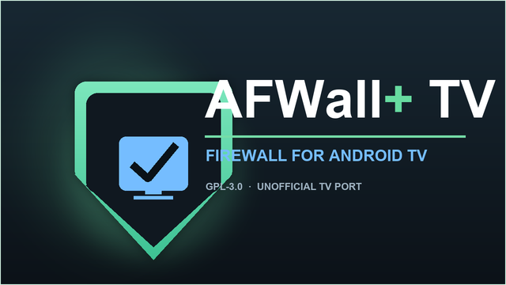
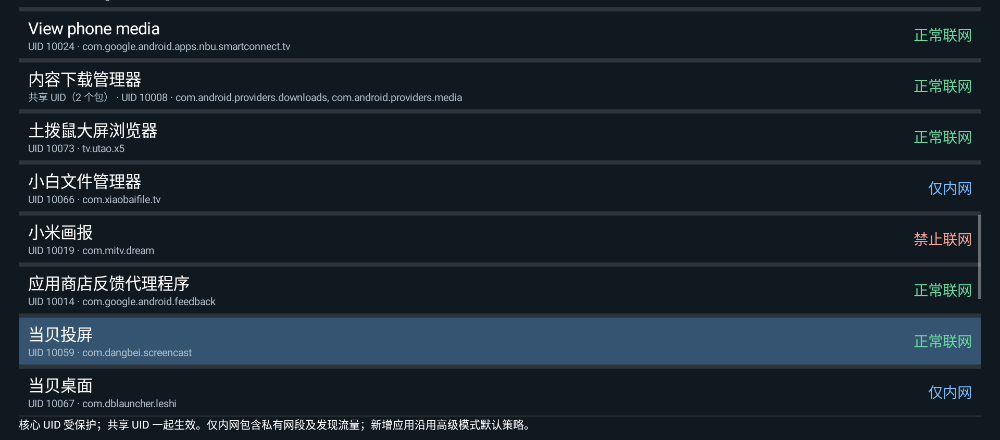

# AFWall+ TV

[English](README.md) · [简体中文](README.zh-CN.md)

[](https://github.com/demoshow/afwall-tv/actions/workflows/ci.yml)
[](https://github.com/demoshow/afwall-tv/actions/workflows/release.yml)

A remote-friendly, three-policy application firewall interface for rooted Android TV devices.

## Download / 下载

Signed APKs, `SHA256SUMS` and the matching source archive are published on the
[Releases](https://github.com/demoshow/afwall-tv/releases) page. Verify the
checksum before installing. Release APKs are signed by this project’s maintainer
and are not official AFWall+ builds. See [docs/CI-SIGNING.md](docs/CI-SIGNING.md).

## Relationship to AFWall+

**The firewall core and substantial majority of the application come from
[AFWall+](https://github.com/ukanth/afwall).** This unofficial adaptation is based on
[`acfebf0f04c807acd7fe80b27d09c04e9b581e74`](https://github.com/ukanth/afwall/tree/acfebf0f04c807acd7fe80b27d09c04e9b581e74).
Credit belongs to Umakanthan Chandran, the AFWall+ contributors, Rodrigo Zechin
Rosauro and the other original authors. Thank you for the engine, advanced UI,
native integration and existing translations/tests that make this adaptation
possible. [Upstream documentation](https://github.com/ukanth/afwall/wiki) ·
[Support AFWall+](https://github.com/ukanth/afwall#support-afwall-development).

## TV-specific additions

- Three explicit policies per UID group: **Unrestricted**, **LAN only**, **Blocked**.
- D-pad navigation, OK selection, Back/discard handling and advanced-UI focus/click support.
- Shared-UID grouping and protection of core, maintenance and this app’s own UIDs.
- English/Chinese TV resources following the system language; other locales fall
  back to English. Upstream advanced-screen translations remain available.
- Policy mapping into the existing allowlist/blocklist mode, regression tests,
  and a fix for the default custom-rule flag incorrectly blocking application.

Editing creates a draft. Only an explicit apply confirmation and root grant
activate rules. Advanced mode, scripts, direct rules and Tor settings are retained.

## Branding




The app icon and TV banner are original project branding for this unofficial
TV port, distributed under GPL-3.0-or-later with the application. Their source
and generator are in [docs/branding](docs/branding/README.md).

## Screenshots

Real captures from a CM311-1 (S905L3, Android 9, system language Chinese) running
AFWall+ TV 1.0.1-tv:




The test device used a Chinese system locale; English strings are included and
are selected automatically when the system language is English.

## Policies and limitations

| Policy | Intended direct app traffic |
| --- | --- |
| Unrestricted | No additional app restriction |
| LAN only | Allow engine-defined LAN/private/discovery destinations; restrict Wi-Fi/Ethernet internet, mobile and VPN traffic |
| Blocked | Restrict direct LAN/WAN traffic, subject to engine exceptions |

These are rule intentions, not complete-isolation guarantees. DNS, loopback,
system proxies, VPN routing, kernel/OEM behavior, existing advanced rules and
boot timing can affect results; root-capable software can change rules. LAN only
is not a single-NAS/IP allowlist. Packages sharing a UID cannot be filtered
separately. Boot restoration does not guarantee zero early traffic.

New apps follow the advanced mode default: allowed in blocklist mode, blocked
in allowlist mode. Advanced checkboxes mean allowed in allowlist mode and blocked
in blocklist mode; the TV labels keep the same meaning through conversion.

## Requirements and first use

1. Android 7.0/API 24+, a compatible root manager, and working kernel
   iptables/ip6tables support are required. Minimum SDK is not device certification.
2. Build the app using [BUILDING.md](docs/BUILDING.md). The application ID is
   `io.github.demoshow.afwalltv`; the Java namespace stays `dev.ukanth.ufirewall`.
   This is a separate installation without automatic old-data/root-grant/Tasker
   migration; see [APP_ID.md](docs/APP_ID.md). Signed APKs and source archives
   are published on the Releases page; see [docs/CI-SIGNING.md](docs/CI-SIGNING.md).
3. Start with one nonessential app: select a policy, choose **Apply rules**, read
   the confirmation and grant root yourself. Applying enables the LAN/IPv6/VPN/
   roaming/tethering columns needed to represent the policies.
4. Verify LAN/WAN and IPv4/IPv6 on that device. **Disable firewall** removes this
   app’s rules while retaining saved selections.

**Do not enable upstream AFWall+ and this app simultaneously: they share iptables
chain names.** Keep local recovery access, avoid restrictive system/root/ADB rules,
and disable the firewall before uninstalling. See [SECURITY.md](SECURITY.md).

## Build and test

Use JDK 17, SDK/compile/target 34, Build Tools 34.0.0, Gradle 8.7 and AGP 8.5.0.

```sh
git clone https://github.com/demoshow/afwall-tv.git
cd afwall-tv
./gradlew :app:testDebugUnitTest :app:lintDebug :app:assembleRelease --no-daemon
python3 scripts/verify_tv_resources.py
```

Release output is unsigned; manage your own private signing material outside
the repository. First builds/tests download dependencies and Android test artifacts.
Inherited native helpers and their source/terms are listed in
[THIRD_PARTY.md](THIRD_PARTY.md); byte-reproducible native builds are not claimed.
JVM/resource tests do not validate physical remotes, root dialogs, boot behavior
or real isolation: use the [manual checklist](docs/TESTING.md).

The TV additions introduce no analytics/cloud account requirement, but inherited
optional external links and DNS/hostname lookups remain; this is not an offline
or security-audit claim. Redact logs and inventories when
[reporting issues](https://github.com/demoshow/afwall-tv/issues).
[Contributing](CONTRIBUTING.md).

## License

GNU GPL-3.0, with later-version permission where granted by original file notices.
Third-party components retain their own terms. See [LICENSE](LICENSE),
[NOTICE.md](NOTICE.md) and [THIRD_PARTY.md](THIRD_PARTY.md). The preserved upstream
Git history does not remove attribution or corresponding-source obligations.
