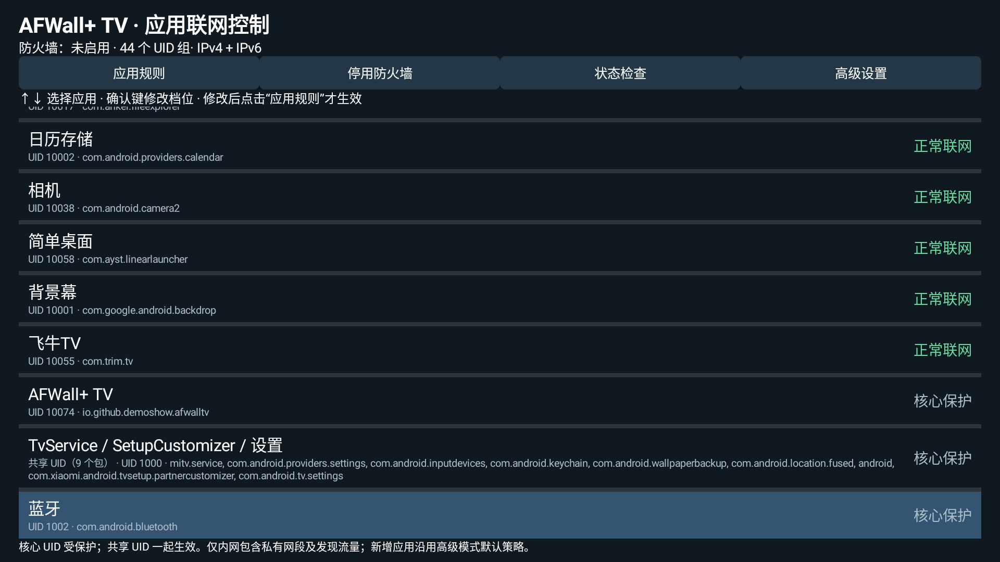

# AFWall+ TV

[English](README.md) · [简体中文](README.zh-CN.md)

面向已获取 root 权限的 Android TV 设备，提供遥控器友好的三档应用联网控制界面。

## 与 AFWall+ 的关系

**防火墙核心及绝大部分应用实现来自 [AFWall+](https://github.com/ukanth/afwall)。**
本非官方适配版本基于提交
[`acfebf0f04c807acd7fe80b27d09c04e9b581e74`](https://github.com/ukanth/afwall/tree/acfebf0f04c807acd7fe80b27d09c04e9b581e74)。
主要贡献归于 Umakanthan Chandran、AFWall+ 贡献者、Rodrigo Zechin Rosauro 等
原作者。感谢他们提供的引擎、高级界面、原生集成及已有翻译和测试。
[上游文档](https://github.com/ukanth/afwall/wiki) ·
[支持 AFWall+](https://github.com/ukanth/afwall#support-afwall-development)。

## TV 版新增功能

- 按 UID 分组提供**正常联网、仅内网、禁止联网**三档策略。
- 支持方向键、确认键、返回/放弃草稿，以及高级界面的焦点和点击适配。
- 合并展示共享 UID，保护系统核心、维护及防火墙自身 UID。
- 电视层跟随系统切换中英文，其他语言回退为英文；保留高级界面已有翻译。
- 将三档映射到现有白名单/黑名单模式，补充回归测试，修复默认自定义规则标志
  被误判为阻止应用规则的条件。

修改选档只是草稿，明确确认应用并授予 root 后才生效；保留既有高级模式、脚本、
直接规则和 Tor 设置。

### 截图——等待所有者提供真实画面

截图位置预留在 [docs/images/](docs/images/README.md)。以下引用暂以注释保留，
收到真实截图后再启用；不会生成假图或把上游截图作为本 TV 界面展示。

<!--  -->
<!--  -->

## 三种策略与限制

| 策略 | 对应用直接流量的预期处理 |
| --- | --- |
| 正常联网 | 不额外限制该应用 |
| 仅内网 | 允许引擎定义的局域网、私有网段和发现地址；限制 Wi-Fi/有线外网、移动数据和 VPN |
| 禁止联网 | 限制直接 LAN/WAN 流量，但仍受引擎例外影响 |

以上是规则意图，不是完全隔离保证。DNS、回环、系统代理、VPN 路由、内核/OEM、
现有高级规则及开机时序都会影响效果；有 root 能力的软件可以改规则。仅内网不是
仅允许某个 NAS/IP 的精确白名单；共享 UID 的应用不能分开限制；开机恢复不能
保证规则恢复前没有流量。

新增应用沿用高级模式默认策略：黑名单默认放行、白名单默认阻止。高级复选框
在白名单下勾选表示允许、黑名单下表示阻止；电视三档通过转换保持相同含义。

## 要求与首次使用

1. 需要 Android 7.0/API 24+、兼容的 root 管理器及可用的内核 iptables/ip6tables
   支持；最低 SDK 不代表所有设备均已认证。
2. 按[构建说明](docs/BUILDING.md)构建。新 applicationId 为
   `io.github.demoshow.afwalltv`，Java 包名仍为 `dev.ukanth.ufirewall`。
   新包独立安装，不会自动迁移旧数据、root 授权或 Tasker 动作，详见
   [APP_ID.md](docs/APP_ID.md)。当前仓库仅发布源码。
3. 从一个非关键普通应用开始：选档、点击“应用规则”、阅读确认框并自行授予
   root。应用时会启用表达三档所需的 LAN/IPv6/VPN/漫游/共享列。
4. 在本机验证内外网及 IPv4/IPv6；“停用防火墙”清理本应用规则并保留已保存选择。

**不要与官方 AFWall+ 同时启用：两者使用同名 iptables 链。** 保留本地恢复手段，
避免贸然限制系统/root/ADB，卸载前先停用规则。详见[安全说明](SECURITY.md)。

## 构建与测试

使用 JDK 17、SDK/compile/target 34、Build Tools 34.0.0、Gradle 8.7 和 AGP 8.5.0。

```sh
git clone https://github.com/demoshow/afwall-tv.git
cd afwall-tv
./gradlew :app:testDebugUnitTest :app:lintDebug :app:assembleRelease --no-daemon
python3 scripts/verify_tv_resources.py
```

Release 默认未签名，私有签名材料由构建者在仓库之外管理。首次构建和测试需要
下载依赖及 Android 测试资源。继承的原生工具与源码/授权见
[第三方说明](THIRD_PARTY.md)，不声称位级可复现。JVM/资源测试不能代替实体
遥控器、root 对话框、开机行为和真实隔离验证，须执行[人工清单](docs/TESTING.md)。

电视层未新增统计或云账号要求，但保留上游可选外链及 DNS/主机名查询；不构成
全离线或安全审计声明。[反馈问题](https://github.com/demoshow/afwall-tv/issues)时
请脱敏日志和应用清单。[贡献说明](CONTRIBUTING.md)。

## 许可证

GNU GPL-3.0；原文件允许时可使用后续版本。第三方组件保持各自授权，详见
[LICENSE](LICENSE)、[NOTICE.md](NOTICE.md)及[THIRD_PARTY.md](THIRD_PARTY.md)。
新 Git 历史不取消署名与完整对应源码义务。

建议 GitHub topics（由所有者在网页手动设置）：`android-tv`、`firewall`、
`iptables`、`afwall`、`root`、`android`。
